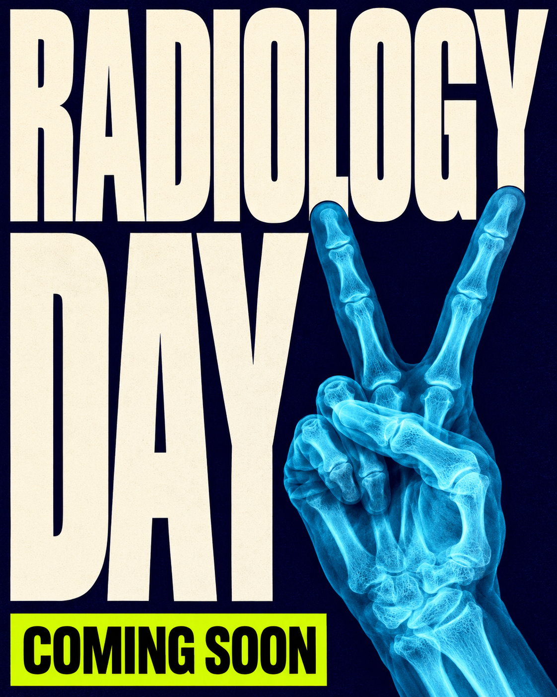
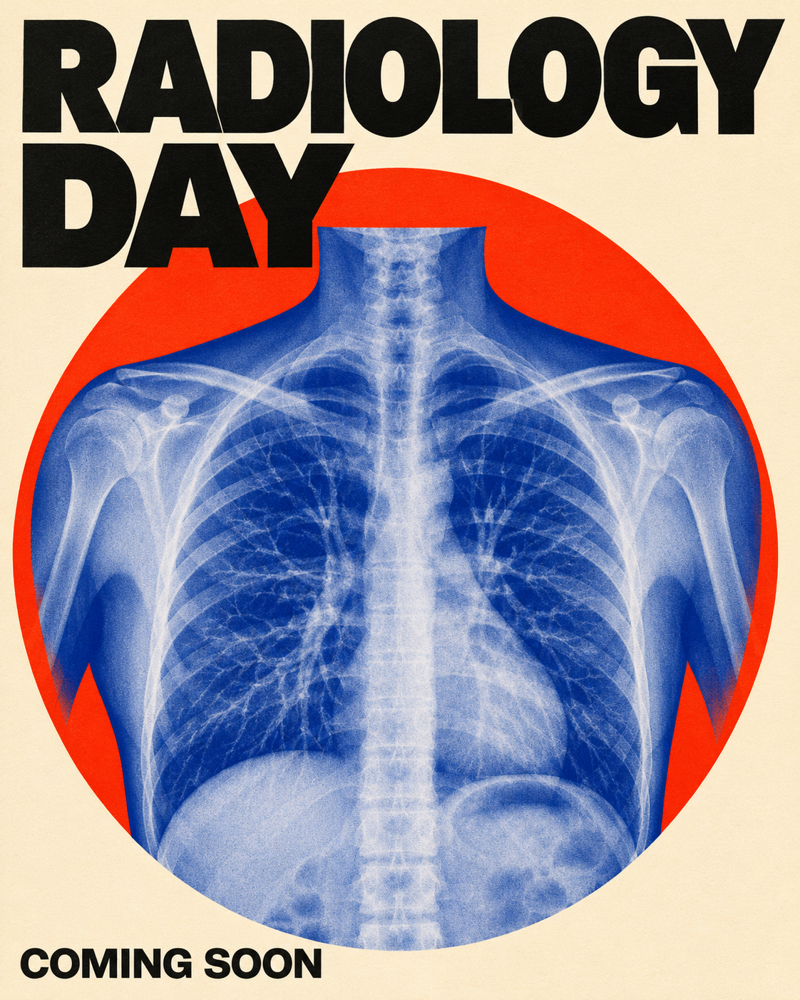
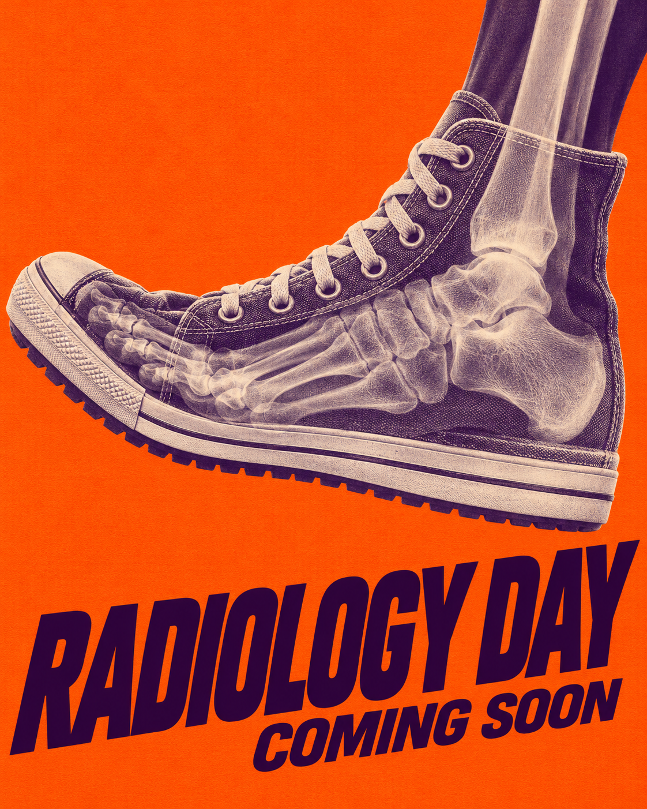
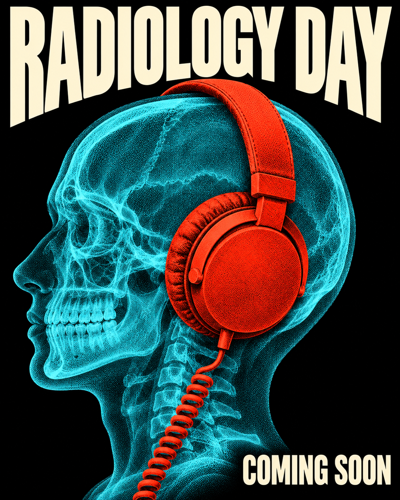
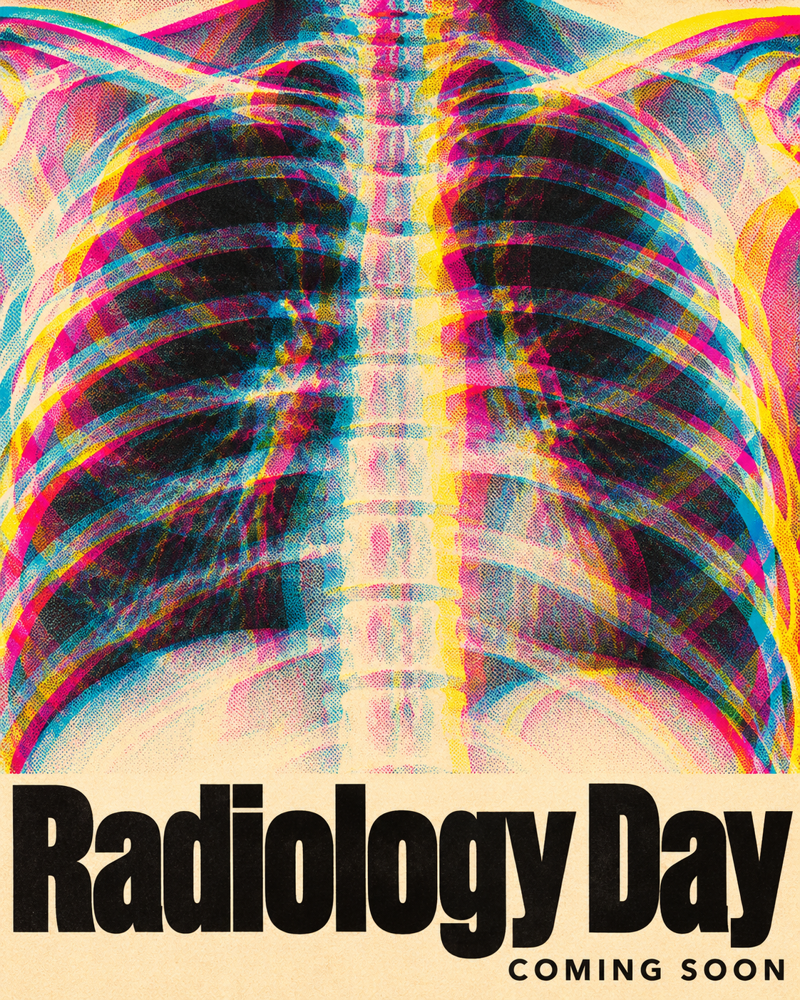

# My Agent Skills

A collection of reusable agent skills by Ahmed Laiq. Each skill packages instructions and supporting resources for a specific workflow.

## Available skills

| Skill | What it does |
| --- | --- |
| [Poster Studio](poster-studio/SKILL.md) | Turns a topic and a short brief into finished posters. Ask for one design or several distinct options, each delivered as a separate file. |
| [Website Design Specification](website-design-spec/SKILL.md) | Inspects a website URL and produces a detailed UI/UX design specification, design tokens, and supporting evidence. |

## Install a skill in Codex

Paste either request into a Codex chat. The installer fetches the complete skill folder from this repository.

```text
$skill-installer Install https://github.com/AhmedLaiq34/My-Agent-Skills/tree/main/poster-studio
```

```text
$skill-installer Install https://github.com/AhmedLaiq34/My-Agent-Skills/tree/main/website-design-spec
```

Once installed, invoke the skill by name in a prompt. For a local checkout or another agent, see the [manual installation instructions](#download-the-repository).

## Poster Studio

Give the skill a subject and a sentence about the audience, mood, or message. Include exact wording in quotes when it needs to appear on the poster.

```text
$poster-studio Make two posters for a university radiology event. Use only “Radiology Day” and “Coming Soon”. Make them bold enough to read on a phone.
```

Poster Studio develops the visual concepts, plans the typography, and checks each exported design at full size and thumbnail size. In Codex it can delegate each design to a dedicated image artist. Illustrated posters use image generation, so run them in an agent with that capability.

<a id="two-takes-on-radiology-day"></a>

### Five takes on Radiology Day

The brief for this university event called for a bold poster using only “Radiology Day” and “Coming Soon.” Across five designs, the same copy takes on the feel of a campus gig, a sneaker ad, or a screen print. Select any poster to open the full-size PNG.

| Peace sign | Chest print |
| --- | --- |
| [](examples/poster-studio/peace-sign.png) | [](examples/poster-studio/chest-print.png) |

| Sneaker | Headphones | Multicolor chest X-ray |
| --- | --- | --- |
| [](examples/poster-studio/sneaker.png) | [](examples/poster-studio/headphones.png) | [](examples/poster-studio/multicolor-chest.png) |

## Website Design Specification

Give `website-design-spec` a URL to document the website's visible design and behavior. It guides the agent through rendered pages, representative page templates, responsive layouts, and interactions.

```text
$website-design-spec Audit https://groq.com. Compare desktop and mobile, then save the specification, design tokens, and evidence.
```

The audit covers:

- Visual language, hierarchy, composition, and the design principles suggested by repeated patterns.
- Color palettes, surfaces, gradients, typography, font verification, spacing, grids, borders, and elevation.
- Components and their observed hover, focus, open, selected, and other interaction states.
- Prominent animations, scroll effects, transitions, and reduced-motion behavior.
- Desktop and mobile differences, navigation, user journeys, content patterns, and asset direction.
- Scoped accessibility and perceived-performance observations, with coverage gaps documented.

Findings distinguish **measured**, **observed**, **inferred**, and **unknown** information. Design philosophy is an interpretation supported by evidence; the report does not claim to recover the designers' original intent or source design system.

### What you receive

```text
your-output-directory/
├── design-spec.md        # Human-readable design specification
├── design-tokens.json    # Normalized values, conditions, and provenance
└── evidence/             # Screenshots, measurements, states, and coverage
```

The token JSON uses the skill's audit format. A DTCG export can be requested separately. The [output contract](website-design-spec/references/specification-format.md) explains the report and token structure.

## Before you install

Use an agent that can read local skill files. A visual audit also needs a rendered browser with screenshots; interaction and measurement capabilities determine how much the agent can verify. Text retrieval alone produces a limited result.

The optional browser helper requires Playwright, Chrome/Chromium, and a Node.js version supported by the installed Playwright release. These dependencies are only needed if the agent uses that helper. See [inspection methods and helper setup](website-design-spec/references/inspection-methods.md).

Install the entire folder for each skill you choose. The manual commands below copy both skills. To install just one, keep only its source folder in the copy command.

## Download the repository

Run these commands in a terminal:

```bash
git clone https://github.com/AhmedLaiq34/My-Agent-Skills.git
cd My-Agent-Skills
```

If you already cloned it, open that checkout and run `git pull --ff-only` instead. You can also use GitHub's **Code → Download ZIP**, extract it, and open the extracted repository folder.

The installation commands below use a macOS/Linux shell and run from the repository root. On Windows, copy the same complete folder to your agent's documented skills location using File Explorer or PowerShell.

## Manual installation for Codex

Copy the folder into your personal skills directory:

```bash
mkdir -p "$HOME/.agents/skills"
cp -R ./poster-studio ./website-design-spec "$HOME/.agents/skills/"
```

Each skill has its own folder under `~/.agents/skills/`. For a project-only installation, copy the folder into that project's `.agents/skills/` instead.

Open Codex CLI or the IDE extension and enter this **in the agent's prompt**, not in your shell:

```text
$website-design-spec Audit https://groq.com and save the specification, tokens, and evidence to ./design-audits/groq.
```

Use `/skills` to find the skill. If it does not appear after installation, restart Codex. The agent can also select it automatically when your request matches its description.

Installation paths and invocation follow the [official OpenAI skills documentation](https://learn.chatgpt.com/docs/build-skills). These instructions cover local skill discovery; cloud environments need access to their own copy.

## Install and use with Claude Code

Copy the folder into your personal Claude Code skills directory:

```bash
mkdir -p "$HOME/.claude/skills"
cp -R ./poster-studio ./website-design-spec "$HOME/.claude/skills/"
```

Each skill has its own folder under `~/.claude/skills/`. For a project-only installation, copy the folder into that project's `.claude/skills/` instead.

Start Claude Code in the directory where you want the output. Invoke either skill in the chat.

```text
/poster-studio Make a poster for a late-night reading club. Use warm lamplight and a quiet mood.

/website-design-spec Audit https://groq.com and save the specification, tokens, and evidence to ./design-audits/groq.
```

The skill can also be selected automatically from a matching request. Local personal skills apply to Claude Code on that machine; Claude web, Cowork, and cloud sessions have separate installation behavior. See the [official Claude Code skills documentation](https://code.claude.com/docs/en/skills).

## Install and use with Gemini CLI

Copy the folder into your personal Gemini CLI skills directory:

```bash
mkdir -p "$HOME/.gemini/skills"
cp -R ./poster-studio ./website-design-spec "$HOME/.gemini/skills/"
```

Each skill has its own folder under `~/.gemini/skills/`. For a project-only installation, copy the folder into that project's `.gemini/skills/` instead. Gemini also recognizes `.agents/skills/` locations, so an existing Codex installation there can be discovered by Gemini.

In Gemini CLI, refresh and confirm discovery:

```text
/skills reload
/skills list
```

Then ask:

```text
Use the poster-studio skill to make a poster for a late-night reading club. Use warm lamplight and a quiet mood.

Use the website-design-spec skill to audit https://groq.com and save the specification, tokens, and evidence to ./design-audits/groq.
```

Confirm activation when Gemini prompts. The [official Gemini CLI guide](https://geminicli.com/docs/cli/using-agent-skills/) documents discovery, linking, and installation. Use the skill name in a natural-language request; `/skills` manages skills.

## Choose the audit scope

Add constraints to any of the prompts above, for example:

```text
Focus on the home and product pages. Compare desktop and mobile, inspect navigation and CTA states, and document prominent animations and reduced-motion behavior. Label unverified details and include an evidence index.
```

The default workflow samples representative public pages. It records blocked or untested areas and keeps submissions, account creation, purchases, and other consequential actions outside an ordinary observational audit.

The skill was tested with a fresh Codex subagent on `groq.com`, covering five templates and producing 55 token records and 105 evidence entries. Claude Code and Gemini CLI installation guidance was checked against their documentation; equivalent audit execution has not been tested on those platforms. Browser access and permissions vary by agent.

## Update an installed copy

Pull changes in your repository checkout:

```bash
git pull --ff-only
```

Repeat the copy command for your chosen agent to refresh its installed files. Reload skills or start a new session if the agent still uses an older copy.

## Add another skill to the collection

Create a separate folder with its own `SKILL.md`, include any resources its instructions reference, and add a row to the skills table above. Keep each skill folder usable on its own.

Installation documentation checked on 25 November 2026. For the audit methodology and its sources, see [research basis](website-design-spec/references/research-basis.md).
